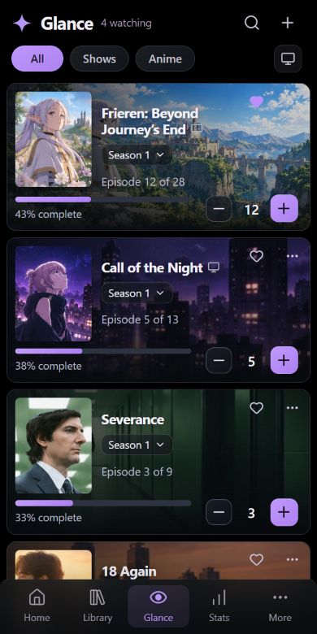
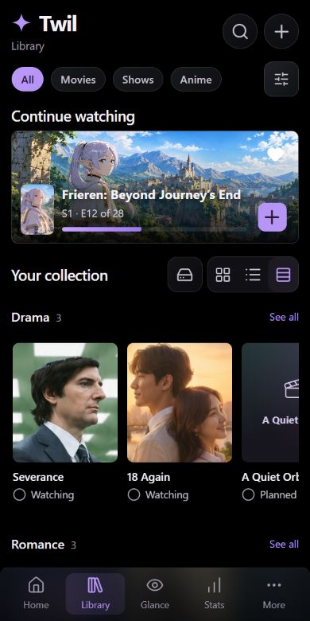
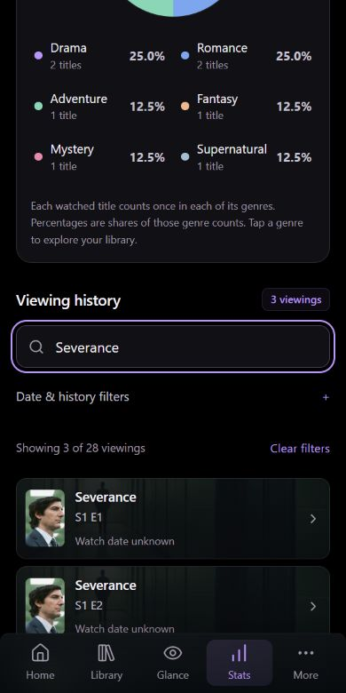
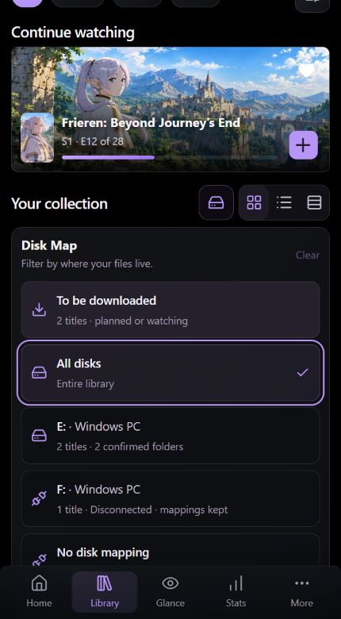

# Daily-use polish and Library tools

21 October 2026. Local implementation only. No commit, push, deployment, cloud resource or firewall change was made.

## Reference comparison and changes

The supplied phone concepts guide the layout, rather than their phone bezel or fictional status bar. The earlier implementation had taller spacing, stretched artwork windows, a lower detail header, heavier controls and weak scenery framing. This increment changes:

- Compact Library heading, circular glass search/add actions, category pills, continuation hero and tighter collection spacing. Default grid remains available alongside list and genre rows.
- Aspect-preserving artwork windows and a clean wide Frieren backdrop. Selective dark gradients keep title text readable while preserving scenery. Shared artwork appears in Glance, continuation and details.
- A higher detail poster/title group, shorter tracking panel, inline synopsis expansion, glass status/season pills and compact episode rows. Visible control surfaces and their interactive targets are sized separately; native selects retain 16 px input text.
- Tinted viewing-history cards with crisp posters, backdrop shading, actual recorded dates and links to titles. Unknown dates remain unknown. Unwatched episode names and artwork stay hidden until revealed.
- One Stats heading instead of duplicated page chrome. Borderless text actions, consistent lavender accents and restrained transitions preserve the AMOLED appearance.

This is not a pixel-identical artwork reproduction: the clean hero is reconstructed, and sample titles, counts and progress remain distinct from the illustrative mockups. Provider ratings are not fabricated. Episode thumbnails use series art until real metadata is available.

## Daily-use features

**Disk Map:** Library can filter by device plus stable volume identity, including multiple copies and changed drive letters. It links to mapped folders. The panel includes **To be downloaded**, All disks, each disk and No disk mapping. Selecting a choice closes the panel and returns focus to its trigger; filters survive in the URL.

**To be downloaded** means planned or watching titles with no mapping, or only confirmed missing files. Disconnected and unverified copies are excluded from that inference. It is a planning filter, not a downloader. Files never imply viewing progress.

**Genre browsing:** the third collection layout groups titles in horizontally scrollable poster rows. Multi-genre titles appear in each relevant row. See all opens that genre in the grid. Rows support keyboard focus, scroll snapping and desktop arrows when needed, without widening the page.

**History and statistics:** Home shows recent artwork-led viewings. Stats includes search, known-date ranges, unknown-date filtering and paged history. The lightweight CSS genre chart has percentages and clickable genre labels. Each title contributes once to each genre; rewatches do not inflate this chart.

Library filtering combines category, status, query, availability, disk, favorites and genre; the sample workspace also has tag filtering. Movie continuation and Glance controls now log a movie viewing rather than showing invalid season/episode counters. Undo restores the movie state. Series continuation describes the selected season's watched count rather than the next episode number.

## Backend wiring and limits

The owner-guarded D1 library API supports exact disk, unmapped, download-queue, favorite and genre filters. Cursor scope includes the filters. Disk summaries aggregate evidence without returning private paths or scanner credentials. The real `/diary` Library uses these APIs and loads disk summaries on demand with retry and stale-response protection. Genre shelves describe loaded titles and expand as pages load; they do not claim to contain the whole remote library.

Cloudflare Access, live D1 and a fresh TMDb token are still unconfigured. `/diary` honestly displays its setup state and disables unavailable disk access. `/preview` uses separate local IndexedDB sample data and does not seed the real diary. Live owner login, scanner uploads, Trakt, full offline synchronization and physical iPhone PWA installation remain later phase work.

## Verification

- `npm run verify`: **77 passing automated tests**, zero Svelte errors/warnings, successful Cloudflare Workers build. See [saved output](verification-latest.log).
- Added tests cover device/volume grouping, copy deduplication, evidence uncertainty, download rules, intersecting filters, cursor scope, typed genres, owner denial, malformed inputs, orphan/revoked history, timezone ordering and genre counts.
- Browser checks at 320, 390, 430 and 1440 px covered inspected Library, genre, Glance and detail layouts. No page-wide horizontal overflow or broken loaded images was found in those checks. At 320 px, the longer Completed status and native 16 px selectors fit.
- Verified disk selection, disconnected-drive filtering, downloads, combined status filters, tag/reset, horizontal genre overflow, See all, history query/date behavior, movie logging/Undo, and episode interaction regressions.
- Fixed a genre row that could widen the document, a disk change that could reset another filter, timezone-offset history sorting and movie 0/0 progress.

This is focused local regression evidence, not a claim of exhaustive production or physical-device performance testing. The owner confirmed the network preview loads on their iPhone.

## Phone preview

Run `npm run dev:network` to listen on the LAN. The current preview is [Library on this Wi-Fi](http://172.16.3.88:5180/preview/library), confirmed reachable by the owner. The address can change with DHCP. The regular `npm run dev` command remains loopback-only. LAN HTTP is suitable for UI review; installed PWA/offline validation needs the later HTTPS environment.

## Screenshots

## Generated artwork provenance

The built-in `image_gen.imagegen` tool edited the owner's supplied reference to create a clean panorama. It was optimized to `static/demo/frieren-hero-v2.jpg` (440,622 bytes, JPEG quality 88) for this local design preview. The original tool output remains at `C:/Users/Amit Singh/.codex/generated_images/01a12953-78d6-79a0-b4fc-498f626ca7ef/exec-cccd17ca-2b5c-47bd-9a47-470b7184f4a1.png`.

Input reference: `C:/Users/AMITSI~1/AppData/Local/Temp/codex-clipboard-6dc5cd7e-a193-42a6-8607-215017a8f43d.png`.

Exact prompt:

> Use case: precise-object-edit. Project asset, not a UI mockup. Extract and reconstruct ONLY the clean panoramic anime illustration at the top of this supplied phone screen: Frieren, silver-lavender-haired elf woman in white cape, standing on the left overlooking the sunlit green valley and medieval mountain castle to the right, stone arch and foliage. Match the reference art's character appearance, exact sunny blue/green palette, framing and detailed painted anime style as closely as possible. Output a standalone wide 16:9 landscape, edge to edge. Remove the phone frame, OS status bar, Dynamic Island, back/heart/menu circles, ALL text, posters, ratings, progress bars, UI and black bottom fade. Reconstruct the obscured scenery naturally. Character occupies left third; castle and mountain vista across right two thirds. No text, logos, borders or UI. This is a backdrop to be displayed behind actual HTML UI.
