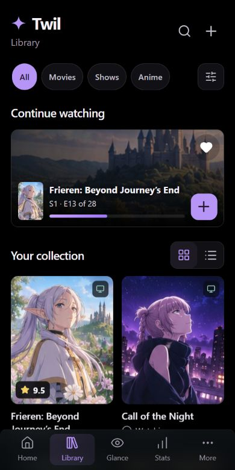
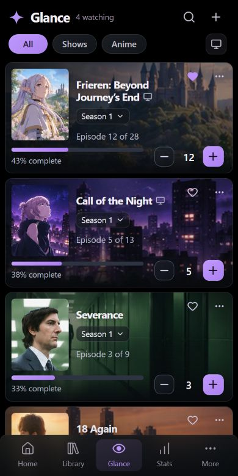
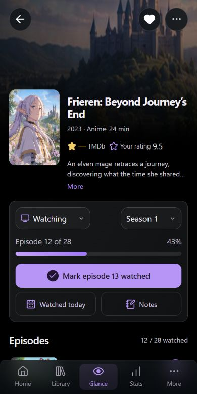

# Reference design alignment

21 October 2026. The owner's three phone mockups are the visual reference for Library, Glance and title details. Continue local development; do not deploy or commit.

Latest geometry, artwork and feature changes are documented in the [daily-use polish report](DAILY-USE-POLISH-REPORT.md), with current screenshots and 77 passing tests. Screenshots below are retained as the earlier alignment checkpoint.

| Area          | Previous variance                                                  | Current implementation                                                                                               |
| ------------- | ------------------------------------------------------------------ | -------------------------------------------------------------------------------------------------------------------- |
| Header        | Global header plus a second page heading and descriptive text      | One page heading, four-point brand mark, compact search/add actions                                                  |
| Navigation    | Four tabs with Glance first and an Activity label                  | Home, Library, Glance, Stats, More; default opening screen remains Glance                                            |
| Library       | Search permanently visible; no continuation hero; status on poster | Search disclosure, four category pills, continuation hero, grid/list switch, score badge on artwork and status below |
| Glance        | Small cover, barely visible poster wash and a text watch button    | Landscape backdrop, larger cover, season selection, percentage bar and minus/count/plus controls                     |
| Detail        | Plain poster/text header with separate controls                    | Full-width backdrop, floating back/favorite/menu controls, poster/title/rating row and one grouped tracking panel    |
| Episodes      | Text-heavy list, five rows and no highlighted next episode         | Three initial rows, artwork area, highlighted Up Next, circular watch control, expandable full season                |
| Daily actions | Notes and availability panels always expanded                      | Notes shortcut opens the editor; drive mappings remain in a separate disclosure                                      |
| Surfaces      | Near-black/violet with weak hierarchy                              | True black background, lavender controls, restrained frosted panels, rounded glass navigation                        |

## Interaction and responsive checks

- Browser-reviewed the three layouts at 320, 390, 430 and 1440 px during implementation. The latest 320 px title check also covers the longer Completed label.
- Fixed a continuation hero whose minimum height could make it wider than its container.
- Fixed status selection clipping at 320 px. Small phone layouts omit the decorative status icon to retain the full label.
- Visible form text remains at least 16 px in the checked layouts. Navigation retains touch-sized controls and safe-area padding.
- Verified Glance increment/decrement and Undo, overflow menus/Escape, search focus, Library search and grid/list switching, a dated viewing reaching history, and Notes/rating validation.
- Season-specific actions use the selected season without consuming an episode from a different season. Automated regression coverage was added.
- Desktop detail uses progress and episode columns instead of stretching the phone's primary action across the entire screen.

## Deliberate content differences

The layout follows the supplied references, but it is not a pixel-identical reproduction of their illustrative artwork or fictional numbers. The four Glance fixtures now use clean artwork regions from the owner's supplied concept; other fixtures retain temporary provider artwork. Personal progress and episode labels remain sample data. Current TMDb ratings are not fabricated: the provider connection is not configured, so its rating is shown as unavailable. Episode artwork is currently series artwork, not a claim to be an episode still.

Unwatched episode text/art remains hidden until revealed, as the owner previously requested. The application does not draw a fake iOS clock, Dynamic Island, phone bezel or home indicator; those belong to the device. Real iPhone Safari and installed-PWA verification remain pending.

## Screenshots

## Latest reference adoption

- Glance uses 8 px phone gutters, 374 px cards at a 390 px viewport, 94 × 118 px covers, stacked title/season/episode information and approximately 179–182 px card heights.
- Category pills paint at 32 px; the season surface is 88 × 26 px; minus/plus surfaces paint at 32/34 px. Interactive targets retain at least 44 px height. Native season selects keep a 16 px input font and a visible keyboard focus ring.
- Title wrapping keeps the PC indicator attached to the last words, reserves space for favorite/menu actions and allows unusually long final words to wrap.
- Selective gradients, thin borders, lavender progress controls and smoked bottom navigation replace the heavier shading. Phone layouts do not reserve desktop scrollbar width.
- Artwork is shared across Glance, Library continuation and title details. All labels and controls remain live HTML/SVG, with existing episode history and selected-season logic preserved.
- Browser checks covered 320, 390, 430 and 1440 px widths, with no horizontal overflow in the inspected layouts. Increment/Undo, PC filtering, overflow menus/Escape, Library navigation and spoiler hiding were verified. Final `npm run verify` passed: 67 tests, zero Svelte errors/warnings and a successful Workers build.

## Artwork provenance

The latest Frieren views use a clean reconstructed panorama at `static/demo/frieren-hero-v2.jpg`, generated with the built-in image tool from the owner's detail reference. Its exact prompt and source are recorded in the [latest report](DAILY-USE-POLISH-REPORT.md#generated-artwork-provenance). The other reference fixtures retain the atlas described below.

`static/demo/glance-reference-atlas.jpg` is a 342,096-byte local JPEG prepared from the owner's supplied Glance concept. CSS image viewports select artwork-only regions; the screenshot's interface and phone chrome are not rendered as application UI. The narrow source regions make the scenic background framing more zoomed than the original mockup. One shared asset serves the four fixtures, with offscreen windows loaded lazily.

Earlier temporary backdrops remain as fallbacks. They were obtained from the [TVMaze image gallery API](https://www.tvmaze.com/api#show-image-gallery), resized to 1200 px wide JPEGs and loaded lazily where offscreen. These are preview fixtures; the selected production metadata source remains TMDb with image hotlinks. No old app API key was reused.

- Frieren: TVMaze image 1313477, [show source](https://www.tvmaze.com/shows/69956/frieren-beyond-journeys-end)
- Call of the Night: TVMaze image 1045485, [show source](https://www.tvmaze.com/shows/59678/call-of-the-night)
- Severance: TVMaze image 992687, [show source](https://www.tvmaze.com/shows/44933/severance)
- 18 Again: TVMaze image 679884, [show source](https://www.tvmaze.com/shows/49598/18-again)
