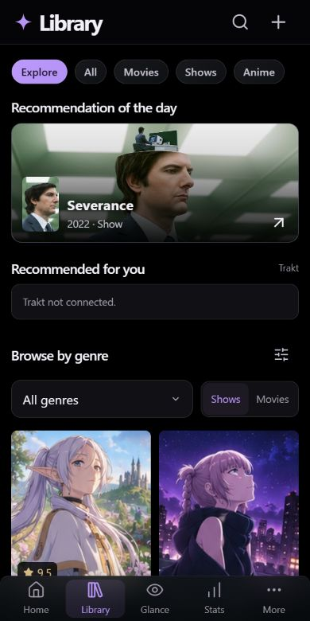
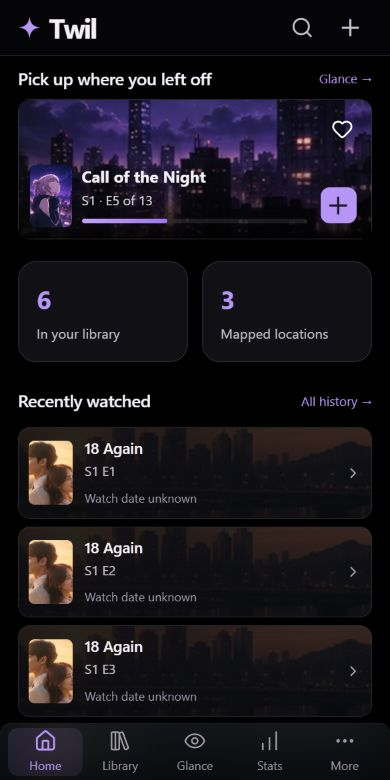
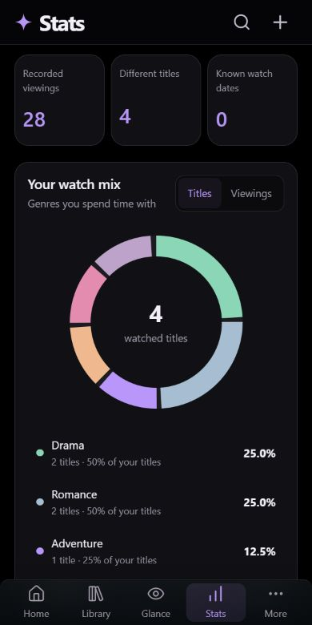

# Explore and daily navigation polish

21 October 2026. Local work only; no commit, push or deployment.

## Final UI

- One persistent header: Twil on Home; Library, Glance, Stats, More or Files & drives elsewhere. Titles are 32 px on desktop and about 27 px on phone, with a short letter animation. Search and add actions live in that header; duplicate visible page headings are removed.
- Home's pickup section starts 12 px below the phone header. The bottom navigation uses less vertical padding while retaining safe-area space.
- Genre rows now calculate the same poster width as the main grid. Both measured 176 px at a 390 px viewport. The card typography and artwork ratio are shared.
- Home and Library rotate through current watches every five seconds. Native horizontal scrolling permits touch swiping. Rotation pauses for keyboard focus, pointer hover on a mouse device, hidden/offscreen content and reduced motion. No hint, counter or pause strip takes space below the card; keyboard users can reveal the pause/previous/next controls, and desktop arrows appear on hover.
- Notifications dismiss after four seconds, or eight seconds when Undo is available. Mouse hover and keyboard focus pause dismissal. Repeated identical notifications restart their timer. Touch pointer entry does not indefinitely pause a phone notification.
- Stats uses an explicit 240 × 240 SVG donut, rather than a CSS-sized ring. Titles and Viewings modes distinguish unique titles from recorded episode/movie events. Counts, genre share, coverage, selection highlighting and genre-library links explain the data. Genre colors remain stable between modes. Revoked/orphan events are excluded; unknown dates remain included without inventing dates.
- Explore is the first Library category. Its final order is **Recommendation of the day → Recommended for you → Browse by genre**. The introduction and source filter chips were removed at the owner's request. Genre is directly selectable; year, minimum rating and highest-rated/newest sorting live in the additional filter panel. The daily pick is independent of genre filters.

## Bugs found and fixed

- A shallow navigation changed the address without switching Explore. The UI now reads SvelteKit 3's `page.shallow.url` as well as the loaded page URL.
- A delayed carousel scroll event could reference its cleared element binding during navigation. Handlers use their own event target; resize callbacks retain their mounted element reference and timers are cleaned up.
- View-transition overlays could intercept quick tab taps. They now ignore pointer events, and interrupted transitions are skipped before a new one starts. Only content fades; header/navigation geometry stays stable.
- Moved search/add controls could sit below the header's stacking context. They now render in the actual header through an instance-owned controller.
- Phone category chips in the real workspace can scroll instead of overflowing when Explore is added.

## Provider wiring and remaining setup

`GET /api/discovery` is owner-guarded and uses D1 to resolve existing library identities. It supports validated TMDb discovery filters and bounded **personal** Trakt recommendations, enriched with TMDb artwork. Existing library matches open their title; new results open the dedicated review/edit dialog before saving. The API also supports related-title queries for later use; the Because you watched UI was removed as requested.

The Trakt client calls only personal recommendation reads, never a community fallback. Each movie/show request is capped at eight recommendations with four concurrent metadata lookups. Both categories are combined in Explore. Credentials remain server-only, upstream responses are bounded and errors never echo provider bodies or tokens. Client response caches are instance-owned, bounded and cleared on unmount. Private API responses use `private, no-store`.

The live Access/D1/TMDb setup and personal Trakt authorization are **not configured**. `.dev.vars.example` documents the optional server-only `TRAKT_PERSONAL_ACCESS_TOKEN` for an existing authorization; a durable sign-in/automatic-refresh UI is still outstanding. No token was requested, copied from the old app or put into browser code. `/preview` remains sample data; its Trakt section therefore says “Trakt not connected.”

Implementation references: [TMDb discovery](https://developer.themoviedb.org/reference/discover-movie), [TMDb related recommendations](https://developer.themoviedb.org/reference/tv-series-recommendations), and [Trakt's official API contracts](https://github.com/trakt/trakt-api/tree/master/projects/api/src/contracts/recommendations). The official Trakt contract confirms these recommendation endpoints require OAuth.

## Verification

- **87 tests pass**, zero Svelte errors/warnings and a successful Cloudflare Workers build; [verification output](verification-latest.log).
- Ten new tests cover discovery input bounds, genre/year/rating intersections, deterministic daily selection, chart denominators, provider request shape, unsafe artwork rejection, personal-token requirements, malformed/oversized/rate-limited responses, anonymous denial and watched seed reads.
- Browser checks at 320, 390 and 1440 px found no page-wide horizontal overflow in the inspected views. The chart measured 240 × 240 at both tested phone widths. Main and genre poster widths matched at 390 px.
- Checked automatic carousel advancement, keyboard previous/next, watched notification expiry, restored sample progress, top search/add and dialog dismissal, Explore ordering, genre/year sorting and a stable daily pick while filtering.
- After the navigation fix, eight successive transitions reached the expected Home/Stats/Library/Glance/More routes, with no errors in a fresh browser session. This is browser regression evidence, not physical iPhone Safari testing.

A temporary sample-only remote tunnel was attempted for phone review, then stopped when the owner asked to leave remote UI for now. Its helper proxy was removed. The existing local development server remains running. No firewall rule or production hosting configuration was changed.

## Screenshots

