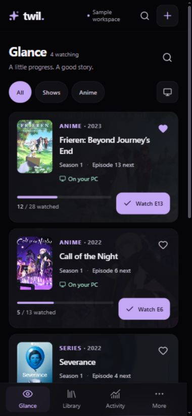
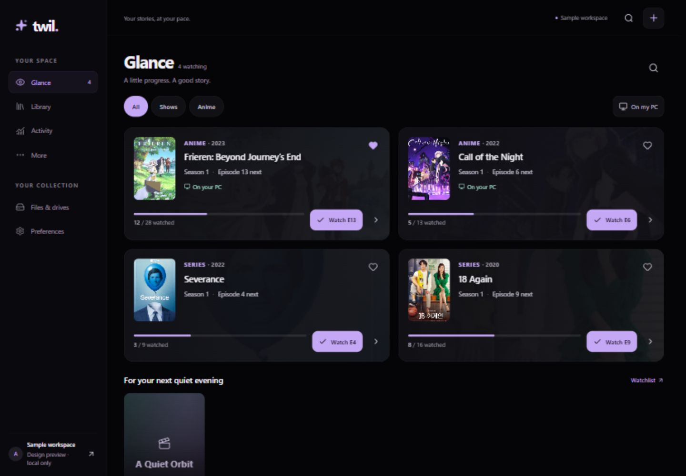

# Local foundation and preview report

21 October 2026. This report describes the current checkout, not a production release.

## Implemented

- New SvelteKit/TypeScript application, Cloudflare Workers adapter and local D1 configuration. No old application source, private library or credentials were copied.
- AMOLED surfaces, restrained glass effects, shared lavender/mint tokens, SVG icons, desktop sidebar and phone bottom navigation.
- Isolated sample workspace: Glance, Library, title details, episode actions, spoiler reveal, favorites, score/notes, watch activity, file-location evidence and preferences.
- Separate domain rules for watches/rewatches/undo, stable title identity and drive availability.
- Typed Drizzle schema with nine tables, generated migration, indexed library order, composite foreign keys and operation deduplication.
- Server verification of signed Cloudflare Access assertions, configured owner, issuer, audience, required expiry/issue time/subject and token type. Browser writes also require a matching Origin. Scanner authentication remains a later implementation.

## Verification evidence

| Check               | Result                                                                                                                                                          |
| ------------------- | --------------------------------------------------------------------------------------------------------------------------------------------------------------- |
| `npm run verify`    | Passed: Svelte check with zero errors/warnings, 32 tests, Workers production build                                                                              |
| `npm audit --json`  | Zero known vulnerabilities at verification time                                                                                                                 |
| Generated migration | Applied to Wrangler's local D1; database integrity tests also execute it with SQLite foreign keys enabled                                                       |
| Production guard    | Local production preview returned 503 and `Cache-Control: no-store` for `/`, `/preview`, `/preview/library` and `/api/library` with Access configuration absent |
| Phone layout        | Six routes checked at requested 320, 375 and 390 px widths; no document horizontal overflow or visible form field below 16 px                                   |
| Wider layout        | Six routes at 1440 px; Library/detail/Files/Activity/More at 430 px; Glance at 768 and 1024 px; no observed horizontal overflow                                 |
| Browser environment | Chromium in the Codex in-app browser, local Vite development server, synthetic personal state                                                                   |

The six routes are Glance, Library, Frieren title detail, Files, Activity and More. Viewport dimensions reserve a stable scrollbar gutter. Some multi-route browser runs encountered navigation-tool timeouts; uncompleted checks were not counted. These checks do not substitute for physical iPhone Safari or a complete accessibility audit.

## Workflow checks and fixes

- Marked the next Frieren episode, confirmed progress advanced, then undid exactly that watch.
- Revealed one unwatched episode without revealing its neighbors.
- Rejected a score above 10, then saved a valid decimal score and note; confirmed persistence after reload.
- Fixed a hydration timing bug that initially populated the editor before saved IndexedDB state arrived.
- Searched Library, selected an existing title in the add dialog and opened its existing detail page. Unit tests also cover renamed stable identities and normalized duplicate matching.
- Confirmed the two-step add dialog preserves the page's content width when opened.
- PC-only filtering showed the two positively available sample titles, excluding the disconnected-drive title.
- Fixed development context identity across hot updates, tightened required JWT claims, raised secondary text floors and ensured season selection uses 16 px text.
- Replaced icon barrel imports with individual icon modules to reduce development/build work. No measured iPhone startup claim is made.

## Screenshots

## Scope still outstanding

Phase 1 has a working representative preview, but its full exit matrix is not yet signed off: 200% text enlargement, keyboard-only traversal, reduced motion, storage failure/eviction and all loading/error/empty states still need broader verification.

Phase 2 currently has the database and authorization foundation. Live library APIs, TMDb integration, persistent cloud writes, metadata correction/merge, Trash and bulk actions are not connected. The actual diary starts empty and the sample workspace never seeds D1.

The Windows scanner, import, Trakt sync, durable offline operation queue, service worker, Apple touch icons and real iPhone install/reopen testing remain in later phases. Unsaved form navigation protection and persistent spoiler preferences also need completion before daily-use release. A baseline manifest and SVG favicon alone are not an install-ready iOS PWA.

No Cloudflare resource, Access policy, DNS setting or remote database has been created or changed. There have been no commits, pushes or deployments. The old Netlify application is untouched.

## Temporary artwork references

The preview uses four local promotional poster samples obtained from TVMaze. They are design fixtures, not a metadata integration or a claim of ownership. Production metadata/posters will use the owner's selected TMDb API and image URLs; no old API key was reused.

- [Frieren](https://www.tvmaze.com/shows/69956/frieren-beyond-journeys-end)
- [Call of the Night](https://www.tvmaze.com/shows/59678/call-of-the-night)
- [Severance](https://www.tvmaze.com/shows/44933/severance)
- [18 Again](https://www.tvmaze.com/shows/49598/18-again)

Personal scores, progress, paths and episode labels in the preview are fictional. The two movie placeholders are fictional too.
